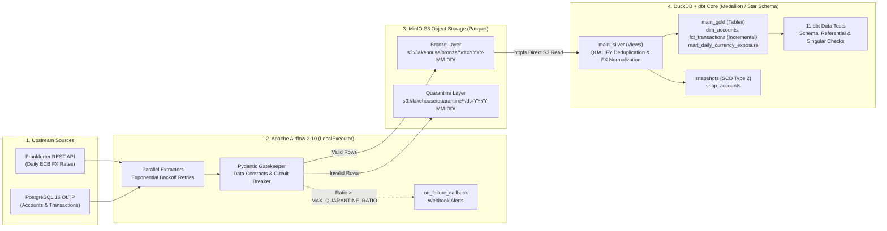

<div align="center">

# Financial Lakehouse Pipeline

**Containerized Modern Data Stack (ELT) for Multi-Currency Financial Analytics & Data Quality Governance**

[](https://python.org)
[](https://airflow.apache.org)
[](https://docs.docker.com/compose/)
[](https://www.getdbt.com/)
[](https://duckdb.org/)
[](https://min.io/)
[](https://www.postgresql.org/)
[](.github/workflows/ci.yml)

</div>

---

## Business Problem & Overview

Multi-currency financial operations cannot aggregate raw ledger entries directly across `USD`, `MXN`, `EUR`, `GBP`, `CAD`, and `JPY`—nor can they afford to let upstream API failures, duplicate webhook retries, or negative/malformed transactions silently corrupt executive reporting.

This project implements a **zero-cloud-cost, production-style Data Engineering Lakehouse** running locally on Docker Compose. Every daily run ingests incremental OLTP ledger records and live ECB foreign-exchange reference rates, enforces **Pydantic data contracts** with **quarantine routing**, lands immutable **Hive-partitioned Parquet** files in **MinIO (S3)**, and transforms them via **dbt Core + DuckDB** into an audited **Star Schema** with **SCD Type 2** account history.

---

## Architecture



---

## Key Engineering Practices (Beyond "Happy-Path" Pipelines)

| Pattern | Implementation | Why It Matters in Production |
| :--- | :--- | :--- |
| **Idempotent Backfills** | Airflow TaskFlow DAG (`financial_lakehouse_daily`) parameterized by logical date `ds`; [storage.py](src/storage.py) atomically overwrites only `dt=YYYY-MM-DD/`. | Re-running or backfilling historical dates never appends duplicate rows. |
| **Quarantine (Dead Letter Parquet)** | [contracts.py](src/quality/contracts.py) validates every row via Pydantic; bad rows (e.g., negative amount, unknown currency `"XXX"`) are routed to `quarantine/` with `_rejection_reason`. | Prevents dirty records from polluting Gold marts while keeping auditability for operations. |
| **Data Quality Circuit Breaker** | If `invalid_rows / total_rows > MAX_QUARANTINE_RATIO`, raises `DataQualityThresholdError` and aborts downstream loads. | Protects the warehouse from systemic upstream schema breakages. |
| **API Retry Resilience** | [fx_api.py](src/extractors/fx_api.py) wraps HTTP calls with `tenacity` exponential backoff + jitter on HTTP `429` / `5xx` / timeouts; Airflow tasks retry `3x` with exponential delay. | Survives transient network blips and API rate limits cleanly. |
| **Silver Deduplication** | [stg_transactions.sql](dbt/models/staging/stg_transactions.sql) uses `QUALIFY ROW_NUMBER() OVER (PARTITION BY tx_id ORDER BY tx_timestamp ASC) = 1`. | Eliminates duplicate events caused by upstream webhook retries. |
| **Incremental Facts & SCD Type 2** | [fct_transactions.sql](dbt/models/marts/fct_transactions.sql) uses `delete+insert` incremental materialization; [snap_accounts.sql](dbt/snapshots/snap_accounts.sql) tracks tier/risk changes over time. | Avoids full-table recomputation and preserves historical account states. |
| **Automated CI/CD** | [ci.yml](.github/workflows/ci.yml) runs `ruff check`, `pytest`, local Bronze ingestion, `dbt run`, `dbt snapshot`, and `dbt test` on every push/PR. | Enforces code quality and SQL contract integrity before merging. |

---

## Data Warehouse Model & Verified Output

### Medallion Layers (`DuckDB`)

| Layer / Schema | Object | Type | Grain / Responsibility |
| :--- | :--- | :--- | :--- |
| **Bronze (S3)** | `bronze/fx_rates`, `accounts`, `transactions` | Parquet (`dt=YYYY-MM-DD`) | Immutable validated source snapshots |
| **Quarantine (S3)** | `quarantine/transactions` | Parquet (`dt=YYYY-MM-DD`) | Rejected records + `_rejection_reason` + `_rejected_at_utc` |
| **`main_silver`** | `stg_fx_rates`, `stg_accounts`, `stg_transactions` | dbt Views | Typed, cleaned, deduplicated records read from S3 via `httpfs` |
| **`main_silver`** | `int_transactions_enriched` | dbt View | Joins accounts + daily FX rates to compute `amount_usd` and `amount_mxn` |
| **`main_gold`** | `dim_accounts`, `dim_currency_rates` | dbt Tables | Conformed Star Schema dimensions |
| **`main_gold`** | `fct_transactions` | dbt Incremental Table | Deduplicated multi-currency fact table (`delete+insert` on `tx_id`) |
| **`main_gold`** | `mart_daily_currency_exposure` | dbt Table | Daily exposure aggregated in original currency, `USD`, and `MXN` |
| **`snapshots`** | `snap_accounts` | dbt Snapshot (SCD2) | Historical tracking of `account_tier`, `kyc_status`, and `risk_segment` |

### Sample Verified Query Output (`main_gold.mart_daily_currency_exposure`)

After running the Dockerized Airflow DAG across `2026-11-15` and `2026-11-16` (with intentional duplicate `tx_id` deduplicated and 2 malformed transactions routed to Quarantine per day):

```text
     tx_date currency  transaction_count  total_original_amount  total_usd_equivalent  total_mxn_equivalent
0 2026-11-16      USD                  1                2150.00               2150.00              39905.94
1 2026-11-16      EUR                  1                1800.50               1983.06              36807.39
2 2026-11-16      MXN                  1               34200.00               1842.58              34200.00
3 2026-11-16      GBP                  1                 950.00               1253.84              23272.47
4 2026-11-16      CAD                  1                1240.00                868.04              16111.67
5 2026-11-15      USD                  2                7850.50               7850.50             145964.35
...
```

---

## Quickstart

### Option A: Full Containerized Stack (Docker + Airflow + MinIO S3 + Postgres + dbt)

1. **Create environment file:**
   ```bash
   cp .env.example .env
   ```
2. **Build and start all services:**
   ```bash
   docker compose up -d --build
   ```
3. **Access the Web UIs:**
   * **Airflow Webserver:** `http://localhost:8080` — login `admin` / `admin`
   * **MinIO S3 Console:** `http://localhost:9001` — login `minioadmin` / `minioadmin123` (inspect `lakehouse/bronze/` and `lakehouse/quarantine/`)
4. **Run or Backfill a specific logical date via CLI:**
   ```bash
   docker compose exec airflow-scheduler airflow dags test financial_lakehouse_daily 2026-11-16
   ```
5. **Query the Gold warehouse from host Python:**
   ```bash
   python -c "import duckdb; con=duckdb.connect('data/warehouse/financial_lakehouse.duckdb', read_only=True); print(con.execute('SELECT * FROM main_gold.mart_daily_currency_exposure').fetchdf())"
   ```

### Option B: Fast Local Mode & Automated Tests (No Docker Required)

```bash
pip install -r requirements.txt
ruff check .
pytest
python -m src.pipelines.local_runner --date 2026-11-15 --mock-api
```

---

## Repository Structure

<details>
<summary><b>Click to expand full project layout</b></summary>

```text
financial-lakehouse-pipeline/
├── .env.example                        # Environment template (storage, DBs, circuit breaker)
├── .github/workflows/ci.yml            # GitHub Actions CI (ruff, pytest, dbt run/snapshot/test)
├── Makefile                            # Developer shortcuts
├── docker-compose.yml                  # Airflow, PostgreSQL (OLTP + Metadata), Chainguard MinIO
├── pyproject.toml                      # Ruff & Pytest configuration
├── requirements.txt                    # Python & dbt dependencies
├── airflow/
│   ├── Dockerfile                      # Airflow 2.10.2 + dbt-duckdb + boto3 image
│   └── dags/
│       └── financial_lakehouse_dag.py  # TaskFlow DAG with retries & failure callback
├── dbt/
│   ├── dbt_project.yml                 # Medallion schema & lakehouse_root configuration
│   ├── profiles.yml                    # local & docker_s3 (DuckDB httpfs) targets
│   ├── snapshots/snap_accounts.sql     # SCD Type 2 account history
│   ├── models/
│   │   ├── staging/                    # stg_fx_rates, stg_accounts, stg_transactions
│   │   ├── intermediate/               # int_transactions_enriched (USD/MXN FX conversion)
│   │   └── marts/                      # dim_accounts, dim_currency_rates, fct_transactions, mart_*
│   └── tests/                          # Singular SQL data quality assertion
├── infra/postgres/init.sql             # Fintech OLTP seed data + intentional duplicates & bad rows
├── src/
│   ├── config.py                       # Typed Pydantic settings
│   ├── storage.py                      # Idempotent Parquet partition writer (Local & MinIO S3)
│   ├── alerts.py                       # Structured alerting + optional webhook delivery
│   ├── extractors/
│   │   ├── fx_api.py                   # Frankfurter REST client with exponential backoff
│   │   └── oltp_postgres.py            # Incremental PostgreSQL extractor & synthetic generator
│   ├── quality/contracts.py            # Pydantic contracts, quarantine router & circuit breaker
│   └── pipelines/local_runner.py       # Standalone Python + DuckDB runner
└── tests/                              # Unit, contract, idempotency, and E2E DuckDB tests
```

</details>

---

## Design Decisions & Trade-offs

* **DuckDB + MinIO S3 vs. Managed Cloud Data Warehouse:** Combining DuckDB (`httpfs` + `parquet`) with S3-compatible object storage mirrors a modern decoupled compute/storage Lakehouse (Snowflake/BigQuery/Databricks style) with zero cloud spend. Migrating to a cloud warehouse only requires changing the `dbt` adapter and profile.
* **Quarantine Routing + Circuit Breaker vs. Fail-Fast on First Bad Row:** In real payment systems, a single malformed upstream event shouldn't break executive SLAs. Isolating bad rows into `quarantine/` keeps valid data flowing while preserving full auditability, and the configurable `MAX_QUARANTINE_RATIO` circuit breaker still halts the pipeline if upstream corruption becomes systemic.
* **Airflow `LocalExecutor` vs. `CeleryExecutor`:** `LocalExecutor` backed by PostgreSQL supports true parallel task execution (`extract_and_validate_fx_rates` and `extract_and_validate_oltp` run concurrently) without adding Redis/Celery broker complexity for a single-node containerized deployment.
* **Chainguard MinIO (`cgr.dev/chainguard/minio`) + Python Bucket Bootstrap:** Chosen over legacy Docker Hub `minio/minio` images (which were deprecated/removed from public Docker Hub) and distroless-friendly initialization via `boto3` inside `airflow-init`.

---

## Author

**Emiliano López García** — *Software Engineering & Data Engineering*  
[LinkedIn](https://www.linkedin.com/in/emiloop/) · [GitHub](https://github.com/lopezgarciaemi) · `emilog2811@gmail.com`
